# 카카오 비즈메시지 친구톡 API v1.3.0

1. [개요](#1-개요)
2. [용어 정의](#2-용어-정의)
3. [선결 조건](#3-선결-조건)
4. [API 스펙](#4-api-스펙)
5. [발송 타입 별 Example](#5-발송-타입-별-example)
6. [코드 정의](#6-코드-정의)
7. [테스트 방법](#7-테스트-방법)

## 참고 : 변경사항

| 일시       | 변경 내역                                                                                                                                                                                                                    |
|------------|------------------------------------------------------------------------------------------------------------------------------------------------------------------------------------------------------------------------------|
| 2026.10.06 | 카탈로그형 메시지 타입 (FG) 추가                                                                                                                                                                                             |
| 2026.01.05 | 캐러셀 리스트 메시지 줄바꿈 무제한 => 최대 10개                                                                                                                                                                              |
| 2025.12.   | 브랜드 메시지로 변경 <br> - 캐러셀 최대갯수 10개 -> 6개 <br> - 버튼 링크 최대길이 1000자 -> 500자 <br> - 버튼제목 텍스트, 이미지 최대 14글자 그 외 최대 8글자 로 변경                                                        |
| 2024.07.   | - 캐러셀 인트로 정보(carousel.head) 추가<br/>- FP(프리미엄 동영상) 쿠폰 사용 가능                                                                                                                                            |
| 2023.11.29 | - 메시지 타입 추가(FM: 친구톡_커머스, FP: 프리미엄_동영상, FA: 친구톡_캐러셀_커머스)<br/>- 부가 정보(additional_content) 추가<br/>- 와이드 이미지형 버튼 최대 개수 변경(1개 -> 2개)<br/>- 캐러셀 최대 개수 변경(2개 -> 10개) |
| 2023.07.   | 카카오 비즈메시지 친구톡 API 초안 작성                                                                                                                                                                                       |


## 1. 개요

+ 본 문서는 https 프로토콜을 통해 데이터를 json 형식으로 가공하여 GET, POST method를 사용하여 전송하고, json형식의 결과 데이터를 parsing하여 처리할 수 있음을 전제로 작성되었다.

## 2. 용어 정의

### 2.1 허브 파트너(Hub Partner)
+ 제휴한 카카오톡 채널 통해 전화번호로 특정되는 카카오톡 사용자에게 메시지 전송을 대행하는 사업자

### 2.2 카카오톡 채널(Kakao Talk Channel)
+ 카카오톡 계정을 기반으로 한 비즈니스용 카카오톡 아이디
+ 카카오톡 채널 홈페이지([https://center-pf.kakao.com](https://center-pf.kakao.com))를 통해 개설

## 3. 선결 조건
> 메시지 API를 사용하여 메시지 전송을 대행하기 위해 아래의 조건이 선결되어야 한다.

+ 카카오 비즈메시지 센터 API를 통해 **메시지 발송 주체인 카카오톡 채널을 등록**하고, 발신 프로필 키(Sender Key)를 조회할 수 있다.
+ 메시지 전송 시스템의 IP 정보를 블룸에이아이 운영 담당자에게 전달하여 메시지 API 서버에 접근할 수 있도록 **접근 허용 요청**을 해야 한다.

+ 블룸에이아이 운영 담당자를 통해 발송에 필요한 `AgentKey`를 발급 받아야 한다. (발송 시 header에 추가)
+ 비 실시간 발송 시 블룸에이아이 운영 담당자를 통해 `WebHook URL`을 사전에 등록해야 한다.


## 4. API 스펙

### 4.1 Host
> **[개발서버]** `https://test-kakao-bizmessage.lunasoft.co.kr/`

> **[운영서버]** `https://kakao-bizmessage.lunasoft.co.kr/`


### 4.2 메시지 전송 요청

#### 4.2.1 실시간(Realtime)
> 전송 요청한 메시지를 즉시 발송 한 후, 발송 결과에 대한 상태 값(성공, 실패)을 바로 받을 수 있다.<br/>
> 단, 최대 발송량을 30 tps로 권장.<br/>
> (최대 tps 초과 시 timeout으로 인해 발송이 실패 될 수 있기 때문에 대량 발송 시 **비 실시간(non-Realtime)** 발송을 권장)

##### [Request]

+ path : /api/v3/friendtalk/send
+ method : POST
+ header
    + Content-type: application/json
    + agentKey: `사전에 블룸에이아이 운영 담당자를 통해 전달 받은 AgentKey`
+ parameter (json)

| 키                 | 타입       | 필수 | 설명                                                                                                                                                                                                                                     | 예제                                                                                                                                                                                                          |
|--------------------|------------|------|------------------------------------------------------------------------------------------------------------------------------------------------------------------------------------------------------------------------------------------|---------------------------------------------------------------------------------------------------------------------------------------------------------------------------------------------------------------|
| message_type       | text(2)    | Y    | 메시지 타입<br/>(FT: 친구톡_텍스트, FI: 친구톡_이미지, FW: 친구톡_와이드_이미지, FL: 친구톡_와이드_아이템_리스트, FC: 친구톡_캐러셀_피드, FM: 친구톡_커머스, FP: 프리미엄_동영상, FA: 친구톡_캐러셀_커머스)                              | "message_type":"FT"                                                                                                                                                                                           |
| message_key        | text(27)   | Y    | 메시지일련번호 (메시지에 대한 고유값)                                                                                                                                                                                                    | "message_key":"605498276                                                                                                                                                                                      |
| sender_key         | text(40)   | Y    | 발신 프로필 키<br/>                                                                                                                                                                                                                      | "sender_key":"2662e99eb7a1f21abb3955278e9955f5a9a99b62"                                                                                                                                                       |
| country_code       | text       | Y    | 국가코드<br/>(**country_code와 recipient_number의 길이 합이 16자로 제한**)                                                                                                                                                               | "country_code":"82"                                                                                                                                                                                           |
| recipient_number   | text       | N    | 사용자 전화번호<br/>(**country_code와 recipient_number의 길이 합이 16자로 제한**)                                                                                                                                                        | "recipient_number":"01012345678"                                                                                                                                                                              |
| app_user_id        | text(20)   | N    | 앱유저아이디<br/>**recipient_number, app_user_id, user_key 셋 중 하나는 필수이며 동시에 요청 된 경우 recipient_number > app_user_id > user_key 의 우선순위를 가집니다.**                                                                 | "app_user_id":"12345"                                                                                                                                                                                         |
| user_key           | text(30)   | N    | 사용자 식별키<br/>카카오톡 채널 봇을 이용해 받은 카카오톡 채널 사용자 식별키<br/>**recipient_number, app_user_id, user_key 셋 중 하나는 필수이며 동시에 요청 된 경우 recipient_number > app_user_id > user_key 의 우선순위를 가집니다.** | "user_key":"MZjEVK4x18_V"                                                                                                                                                                                     |
| message            | text(1000) | Y    | 사용자에게 전달될 메시지<br/>(공백 포함 1000자로 제한)<br/>FL, FC 타입은 필수 X, FP타입은 선택<br> 텍스트, 이미지 줄바꿈 최대 99 <br> 와이드 이미지, 비디오 최대 줄바꿈 5                                                                | "message":"채널 추가 없이 보내는 정보형 메시지 ‘카카오톡 비즈메시지’를 소개합니다."                                                                                                                           |
| additional_content | text(34)   | N    | 부가 정보<br/>(공백 포함 34자로 제한)<br/> FM 타입에서 사용 <br/>**COMMERCE 줄바꿈: 최대 1개**                                                                                                                                           |                                                                                                                                                                                                               |
| ad_flag            | text(1)    | N    | 광고성 메시지 필수 표기 사항을 노출<br/>(노출 여부 Y/N, 기본값 Y)<br/>FL, FC, FA 타입은 Y로만 발송 가능                                                                                                                                  | "ad_flag":"Y"                                                                                                                                                                                                 |
| adult              | text(1)    | N    | 성인용 메시지 여부 <br/>(성인용 메시지 여부 Y/N, 기본값 N)<br/>                                                                                                                                                                          | "adult":"Y"                                                                                                                                                                                                   |
| attachment         | json       | N    | 메시지에 첨부할 내용<br/>(링크 버튼)                                                                                                                                                                                                     | "attachment":{"button":[{"name":"비즈메시지 소개","type":"WL","url_pc":"https://bizmessage.kakao.com/", "url_mobile":"https://bizmessage.kakao.com/"}]} **[<4.4 Attachment 에서 확인 가능>](#44-attachment)** |
| header             | text(25)   | N    | [ 와이드 아이템 리스트 메시지 타입(FL) 사용시 필수, FP타입의 경우 옵션 ]                                                                                                                                                                 |                                                                                                                                                                                                               |
| header_description | text(36)   | N    | CATALOG - 최대 36자 (줄바꿈: 최대 1회)                                                                                                                                                                                                   |                                                                                                                                                                                                               |
| carousel           | json       | N    | [ 캐러셀 메시지 타입(FC, FA) 사용시 필수 ]                                                                                                                                                                                               | **[<4.5 Carousel>](#45-carousel)**                                                                                                                                                                            |

##### [Response]

| 키      | 타입    | 필수 | 설명                                             | 예제                                                              |
|---------|---------|------|--------------------------------------------------|-------------------------------------------------------------------|
| code    | text(4) | Y    | 처리 결과 코드<br/>(0000은 정상 / 나머지는 오류) | "code ":"0000" **[<6.1 오류코드 에서 확인 가능>](#61-오류-코드)** |
| message | text    | N    | 오류 메시지<br/>(오류시 존재하는 값)             | "message ":"NoSendAvailableTimeException(1)"                      |

##### [Example] (※ 테스트 하기 전에 7.1 테스트 선결 조건을 먼저 확인하세요.)

```
$ curl  -H "Accept: application/json" -H "Content-type: application/json" -X POST -d '{"message_type":"FT","message_key":"00005","sender_key":"2662e99eb7a1f21abb3955278e9955f5a9a99b62","country_code":"82","recipient_number":"01012345678","message":"(광고)채널 추가 없이 보내는 정보형 메시지 \"카카오톡 비즈메시지\"를 소개합니다.","attachment":{"button":[{"name":"비즈메시지 소개","type":"WL","url_pc":"https://bizmessage.kakao.com/", "url_mobile":"https://bizmessage.kakao.com/"}]}}' https://cbt-ext-bzm-api.kakao.com/v3/d856a846049ed4872e2b4664983539c2a6c7444f/friendtalk/send

{"code":"0000"}
```

#### 4.2.2 비 실시간(non-Realtime)
> 전송 요청한 메시지를 Queue에 저장 한 후 순차적으로 발송 한다.<br/>실시간 발송에 비해 tps에 대한 부담이 적으나 발송 결과를 즉시 받지 못하며, 발송 결과를 받을 수 있는 별도의 Webhook 설정이 필요하다.

##### [Request]

+ path : /api/v3/friendtalk/send/async<br/>**나머지 항목들은 위 실시간 발송과 동일함.**

##### [Response]

| 키      | 타입    | 필수 | 설명                                                         | 예제                                                                |
|---------|---------|------|--------------------------------------------------------------|---------------------------------------------------------------------|
| code    | text(6) | Y    | 처리 결과 코드<br/>(LS0000은 발송 요청 성공 / 나머지는 오류) | "code ":"LS0000" **[<6.1 오류코드 에서 확인 가능>](#61-오류-코드)** |
| message | text    | N    | 오류 메시지<br/>(오류시 존재하는 값)                         | "message ":"AckTimeoutException(1)"                                 |

#### 4.2.3 WebHook

> 블룸에이아이 운영 담당자를 통해 `WebHook URL`을 사전에 등록해야 함.

##### [Request]

- path : `블룸에이아이에 사전 등록된 WebHook Url`
- method : `POST`
- header :
  - Content-Type : application/json
- body :

```json
{
  "code": "text",  
  "message_key": "text",
  "message_type": "text",
  "response_dt": "text",
  "message": "text"
}
```
| 키           | 타입     | 필수 | 설명                                                                                                                                      | 예제                                                                    |
|--------------|----------|------|-------------------------------------------------------------------------------------------------------------------------------------------|-------------------------------------------------------------------------|
| code         | text(6)  | Y    | 처리 결과 코드<br/>(0000은 정상 / 나머지는 오류)                                                                                          | "code": "0000" **[<6.1 오류코드 에서 확인 가능>](#61-오류-코드)**       |
| message_key  | text(27) | Y    | 메시지일련번호 (요청시 설정한 메시지일련번호)                                                                                             | "message_key": "605498276"                                              |
| message_type | text(2)  | Y    | 메시지 타입<br/>(FT: 친구톡 텍스트, FI: 친구톡 이미지, FW: 친구톡 와이드 이미지, FL: 친구톡 와이드 아이템 리스트, FC: 친구톡 캐러셀 피드) | "message_type": "FI"                                                    |
| response_dt  | datetime | Y    | 메시지 발송 응답 시간                                                                                                                     | "response_dt": "2023-07-12 15:10:30"                                    |
| message      | text     | N    | 오류 메시지<br/>(오류시 존재하는 값)                                                                                                      | "message": "InvalidParameterException(InvalidMessageTypeException(FA))" |

- 발송 성공 Sample
```json
{
  "code": "0000",  
  "message_key": "605498276",
  "message_type": "FI",
  "response_dt": "2023-07-12 15:10:30"
}
```

- 발송 실패 Sample
```json
{
  "code": "1030",  
  "message_key": "605498276",
  "message_type": "FI",
  "response_dt": "2023-07-12 15:10:30",
  "message": "InvalidParameterException(InvalidMessageTypeException(FA))"
}
```


### 4.3 친구톡 상품 타입
+ 친구톡은 카카오톡 사용자가 발신프로필(카카오톡 채널)의 채널을 추가한 경우 경우 발송되며 발송 성공 기준으로 과금 여부를 판단합니다.
+ 요청 시 recipient_number, app_user_id, user_key 중 하나로 발송가능하며 여러 값이 동시에 요청될 경우 recipient_number > app_user_id > user_key 의 우선순위를 가집니다.<br/>
+ 발송 제약 시간(20시 ~ 익일 08시) 존재합니다.


#### 4.3.1 텍스트 타입

+ 텍스트 타입의 경우 텍스트 메시지 + 링크 버튼 발송이 가능합니다.
+ 텍스트 문구는 1000자로 제한됩니다.

#### 4.3.2 이미지 타입

+ 기본적으로 텍스트 타입과 동일하나 attachment 필드에 이미지를 추가하여 발송 가능<br/>
+ 반드시 내부에 업로드 한 이미지를 발송해야 하며 이미지 업로드는 **[<업로드 API 문서>](/upload-api.md#25-친구톡-이미지-업로드-요청)** 를 확인해주세요.<br/>
+ 이미지 타입의 경우 텍스트 메시지 + 링크 버튼 + 이미지 발송이 가능합니다.
+ 텍스트 문구는 400자로 제한됩니다.

#### 4.3.3 와이드 이미지 타입

+ 기본적으로 텍스트 타입과 동일하나 attachment 필드에 이미지를 추가하여 발송 가능<br/>
+ 반드시 내부에 업로드 한 이미지를 발송해야 하며 이미지 업로드는 **[<업로드 API 문서>](/upload-api.md#26-친구톡-와이드-이미지-업로드-요청)** 를 확인해주세요.<br/>
+ 이미지 타입의 경우 텍스트 메시지 + 링크 버튼(최대 2개) + 이미지 발송이 가능합니다.
+ 텍스트 문구는 76자로 제한됩니다.

#### 4.3.4 와이드 아이템 리스트 말풍선 타입

+ 하나의 말풍선에 여러 아이템 리스트를 attachment.item.list 필드에 담아서 발송 가능<br/>
+ 반드시 내부에 업로드 한 이미지를 발송해야 하며 이미지 업로드는 **[<업로드 API 문서>](/upload-api.md#27-친구톡-와이드-아이템-리스트-이미지-업로드-요청)** 를 확인해주세요.<br/>
+ item > list > title 텍스트 문구는 첫번째 아이템은 25자, 2~4번째 아이템은 30자로 제한됩니다.
+ 최대 4개 / 최소 3개의 아이템 리스트가 필요합니다.
+ 버튼은 최대 2개까지 가능하며 가로 정렬되어 발송 됩니다.
+ 광고 발송만 가능합니다.

#### 4.3.5 캐러셀 피드 말풍선 타입

+ 여러 말풍선을 carousel 필드에 list 로 추가 할 수 있고, 더보기 버튼(tail)을 지정하여 발송 가능<br/>
+ 반드시 내부에 업로드 한 이미지를 발송해야 하며 이미지 업로드는 **[<업로드 API 문서>](/upload-api.md#28-친구톡-캐러셀-피드-이미지-업로드-요청)** 를 확인해주세요.<br/>
+ 제목(헤더)은 20자, 텍스트 문구는 180자로 제한됩니다.
+ 캐러셀 하나 당 버튼은 최대 2개까지 가능하며 가로 정렬되어 발송 됩니다.
+ 캐러셀 1개당 제목(헤더) + 텍스트 문구 + 링크 버튼(2개/가로배열) + 이미지 발송 가능
+ 광고 발송만 가능합니다.

#### 4.3.6 커머스 말풍선 타입

+ 부가 정보는 34자로 제한됩니다.
+ 버튼은 최소 1개 이상 포함되어야 하며, 최대 2개까지 포함 가능하며 가로 정렬되어 발송 됩니다.
+ 상품 제목 + 가격정보 + 부가정보 + 링크 버튼(2개/가로배열) + 이미지 발송이 가능합니다.

#### 4.3.7 프리미엄 동영상 타입

+ 동영상 링크는 카카오TV에 업로드된 영상만 사용 가능합니다(https://tv.kakao.com/v/#{숫자} / https://tv.kakao.com/channel/#{숫자}/cliplink/#{숫자})
+ 헤더는 20자, 텍스트는 76자로 제한됩니다.
+ 헤더와 텍스트는 옵셔널한 값으로 없어도 발송 가능합니다.
+ 버튼은 1개까지 발송가능합니다.

#### 4.3.8 캐러셀 커머스 말풍선 타입

+ 여러 커머스 말풍선을 캐러셀로 발송 가능
+ 캐러셀 인트로가 존재하는 경우 캐러셀은 최소 1개 이상 최대 6개 이하 발송 가능
+ 캐러셀 인트로가 존재하지 않는 경우 캐러셀은 최소 2개 이상 최대 6개 이하 발송 가능
+ 각 캐러셀마다 버튼은 1개 필수이며 최대 2개까지 지원
+ 캐러셀 1개당 상품 제목 + 가격정보 + 부가정보 + 링크 버튼(2개/가로배열) + 이미지 발송 가능
+ 광고 발송만 가능합니다.

#### 4.3.9 카탈로그 타입

+ 카탈로그형 발송 가능
+ 최소 3개 부터 최대 7개 발송 가능
+ 아이템 개수가 홀수 개(3, 5, 7개)의 경우, 첫 번째 이미지를 카탈로그 첫 번째 이미지 업로드를 활용하여 첫 번째 이미지를 등록해야 합니다.<br>이후 나머지 이미지 업로드는 카탈로그 이미지 업로드를 활용하여 등록합니다.
+ 아이템 개수가 짝수 개(4, 6개)의 경우, 카탈로그 이미지 업로드를 활용하여 이미지를 등록합니다.
+ 광고 발송만 가능합니다.

### 4.4 Attachment
친구톡은 **[<4.2 메시지 전송 요청>](#42-메시지-전송-요청)**의 요청 필드 중 attachment 값에 링크 버튼과 이미지를 첨부하여 발송할 수 있다.<br/>
**버튼은 목록으로(Array) 최대 5개까지** 추가하여 발송할 수 있다.<br/>

##### [Parameter]

| 키       | -              | -                   | 타입       | 필수 | 설명                                                                                                                         |
|----------|----------------|---------------------|------------|------|------------------------------------------------------------------------------------------------------------------------------|
| button   |                |                     | array      | -    | 버튼 목록                                                                                                                    |
|          | name           |                     | text       | Y    | 버튼 제목 <br/> 텍스트, 이미지 최대 14글자<br> 그 외 최대 8글자                                                              |
|          | type           |                     | text(2)    | Y    | 버튼 타입 **[<4.4.1 버튼 타입에서 확인 가능>](#441-버튼-타입별-속성)**                                                       |
|          | scheme_android |                     | text(500)  | -    | mobile android 환경에서 버튼 클릭 시 실행할<br/>application custom scheme                                                    |
|          | scheme_ios     |                     | text(500)  | -    | mobile ios 환경에서 버튼 클릭 시 실행할<br/>application custom scheme                                                        |
|          | url_mobile     |                     | text(500)  | -    | mobile 환경에서 버튼 클릭 시 이동할 url                                                                                      |
|          | url_pc         |                     | text(500)  | -    | pc 환경에서 버튼 클릭 시 이동할 url                                                                                          |
| image    |                |                     | json       | N    | 이미지                                                                                                                       |
|          | img_url        |                     | text       | Y    | 노출할 이미지                                                                                                                |
|          | img_link       |                     | text       | N    | 이미지 클릭시 이동할 url<br/>미설정시 카카오톡 내 이미지 뷰어 사용                                                           |
| item     |                |                     | json       | N    | 와이드 아이템 리스트 전용                                                                                                    |
|          | list           |                     | array      | Y    | 와이드 아이템 리스트 (최소:3, 최대: 4)                                                                                       |
|          |                | title               | text       | Y    | 아이템 제목                                                                                                                  |
|          |                | img_url             | text(500)  | Y    | 아이템 이미지 URL                                                                                                            |
|          |                | scheme_android      | text(500)  | N    | mobile android 환경에서 이미지 클릭 시 실행할<br/>application custom scheme                                                  |
|          |                | scheme_ios          | text(500)  | N    | mobile ios 환경에서 이미지 클릭 시 실행할<br/>application custom scheme                                                      |
|          |                | url_mobile          | text(500)  | Y    | mobile 환경에서 이미지 클릭 시 이동할 url                                                                                    |
|          |                | url_pc              | text(500)  | N    | pc 환경에서 이미지 클릭 시 이동할 url                                                                                        |
| coupon   |                |                     | json       | N    | 메세지 최하단에 쿠폰 추가                                                                                                    |
|          | title          |                     | text       | Y    | 쿠폰 상세 설명 <br> FT, FI - 12자 / FW, FL - 18자 제한 <br/> 줄바꿈 불가                                                     |
|          | description    |                     | text       | Y    | 쿠폰 상세 설명 (FW, FL, FP - 18자 제한 / 나머지 - 12자 제한)                                                                 |
|          | url_pc         |                     | text(500)  | -    | pc 환경에서 쿠폰 클릭 시 이동할 url                                                                                          |
|          | url_mobile     |                     | text(500)  | -    | mobile 환경에서 쿠폰 클릭 시 이동할 url                                                                                      |
|          | scheme_android |                     | text(500)  | -    | mobile android 환경에서 쿠폰 클릭 시 실행할<br/>application custom scheme                                                    |
|          | scheme_ios     |                     | text(500)  | -    | mobile ios 환경에서 쿠폰 클릭 시 실행할<br/>application custom scheme                                                        |
| commerce |                |                     | json       | N    | 커머스                                                                                                                       |
|          | title          |                     | text       | Y    | 상품제목 (최대 30자)                                                                                                         |
|          | regular_price  |                     | number     | Y    | 정상가격 (0 ~ 99,999,999)                                                                                                    |
|          | discount_price |                     | number     | N    | 할인가격  (0 ~ 99,999,999)                                                                                                   |
|          | discount_rate  |                     | number     | N    | 할인율  <br/> 할인가격 존재시 할인율, 정액할인가격 중 하나는 필수 (0 ~ 100)                                                  |
|          | discount_fixed |                     | number     | N    | 정액할인가격  <br/> 할인가격 존재시 할인율, 정액할인가격 중 하나는 필수 (0 ~ 999,999)                                        |
| video    |                |                     | json       | N    | 비디오                                                                                                                       |
|          | video_url      |                     | text       | Y    | 카카오TV 동영상 URL                                                                                                          |
|          | thumbnail_url  |                     | text       | N    | 동영상 썸네일용 이미지 URL, 없는 경우 동영상 기본썸네일 사용                                                                 |
| catalog  |                |                     | json       | N    | 카탈로그                                                                                                                     |
|          | list           |                     | array      | Y    | 카탈로그 아이템 목록 (최소 3개, 최대 7개)                                                                                    |
|          |                | type                | text       | Y    | **[<4.4.3 카탈로그 아이템 타입>](#443-카탈로그-아이템-타입)** 참고<br/>타입별 필수 파라미터를 모두 입력해야 메시지 발송 가능 |
|          |                | img_url             | text       | Y    | 이미지 업로드 API로 등록한 아이템 이미지 URL                                                                                 |
|          |                | img_link            | text(1000) | Y    | 이미지 클릭 시 이동할 URL                                                                                                    |
|          |                | title               | text(20)   | Y    | 아이템 제목 (줄바꿈: 불가)                                                                                                   |
|          |                | description         | text(22)   | N    | 아이템 설명 (줄바꿈: 불가)                                                                                                   |
|          |                | regular_price       | number     | -    | 정상 가격 (0 ~ 99,999,999)                                                                                                   |
|          |                | discount_price      | number     | N    | 할인 후 가격 (0 ~ 99,999,999)                                                                                                |
|          |                | discount_rate       | number     | N    | 할인율 (1 ~ 100)                                                                                                             |
|          |                | discount_fixed      | number     | N    | 정액 할인 가격 (0 ~ 999,999)                                                                                                 |
|          |                | regular_price_name  | text(4)    | N    | 정상 가격 명                                                                                                                 |
|          |                | discount_price_name | text(5)    | N    | 할인 후 가격 명                                                                                                              |

##### [Example]

```
"attachment":{"button":[{"name":"비즈메시지 소개","type":"WL","url_pc":"https://bizmessage.kakao.com/", "url_mobile":"https://bizmessage.kakao.com/"}]}

"attachment":{"button":[{"name":"비즈메시지 소개","type":"WL","url_pc":"https://bizmessage.kakao.com/", "url_mobile":"https://bizmessage.kakao.com/"}], "image":{"img_url":"img_url","img_link":"https://bizmessage.kakao.com/"}}

"attachment":{"button":[{"name":"비즈메시지 소개","type":"WL","url_pc":"https://bizmessage.kakao.com/", "url_mobile":"https://bizmessage.kakao.com/"},{"name":"커스텀스킴 테스트","type":"AL","scheme_ios":"scheme://xxx.xx", "scheme_android":"scheme://xxx.xx"}]}

```

#### 4.4.1 버튼 타입별 속성

+ 필수 파라메터를 모두 입력하셔야 정상적인 발송이 가능합니다.

| 버튼타입 | 속성           | 타입      | 필수 | 설명                                                                                                                                    |
|----------|----------------|-----------|------|-----------------------------------------------------------------------------------------------------------------------------------------|
| WL       | url_mobile     | text(500) | Y    | 버튼 클릭 시 이동할 pc/mobile환경별 web url                                                                                             |
|          | url_pc         | text(500) | N    |                                                                                                                                         |
| AL       | scheme_android | text(500) | -    | **scheme_ios, scheme_android, url_mobile 중 2가지 필수 입력**<br/>mobile android 환경에서 버튼 클릭 시 실행할 application custom scheme |
|          | scheme_ios     | text(500) | -    | mobile ios 환경에서 버튼 클릭 시 실행할 application custom scheme                                                                       |
|          | url_mobile     | text(500) | -    | mobile 환경에서 버튼 클릭 시 이동할 url                                                                                                 |
|          | url_pc         | text(500) | N    | pc 환경에서 버튼 클릭 시 이동할 url                                                                                                     |
| BK       | -              | -         | -    | 해당 버튼 텍스트 전송                                                                                                                   |
| MD       | -              | -         | -    | 해당 버튼 텍스트 + 메시지 본문 전송                                                                                                     |
| BC       | -              | -         | -    | 상담톡을 이용하는 카카오톡 채널만 이용가능                                                                                              |
|          | chat_extra     | text      | N    | 상담톡 전환 시 전달할 메타정보                                                                                                          |
| BT       | -              | -         | -    | 카카오 I 오픈빌더의 챗봇을 사용하는 카카오톡 채널만 이용가능                                                                            |
|          | chat_extra     | text      | N    | 봇 전환 시 전달할 메타정보                                                                                                              |
|          | chat_event     | text      | N    | 봇 전환 시 연결할 봇 이벤트명                                                                                                           |

<br/>

#### 4.4.2 쿠폰
+ 쿠폰형은 모든 메세지 타입이 사용 가능함.
+ 세로형 버튼을 사용하는 FT, FI의 경우 쿠폰을 적용할 경우 최대 버튼 4개까지만 사용 가능.
+ title의 경우 5가지 형식으로 제한 됨
    + "${숫자}원 할인 쿠폰" 숫자는 1이상 99,999,999 이하
    + "${숫자}% 할인 쿠폰" 숫자는 1이상 100 이하
    + "배송비 할인 쿠폰"
    + "${7자 이내} 무료 쿠폰"
    + "${7자 이내} UP 쿠폰"
+ url_pc, url_mobile, scheme_android, scheme_ios의 경우 필수값이 두가지 케이스로 구분됨
    + 기본 - url_mobile 필수값 나머지 옵션값
    + 채널 쿠폰 URL(포멧: alimtalk=coupon://) 사용 - scheme_android 혹은 scheme_ios 둘 중 하나 필수값 나머지 옵션값

#### 4.4.3 카탈로그 아이템 타입

| 버튼타입          | 설명                                                                           | 사용 가능 파라미터                                                                                                                     | 필수                                                      |
|-------------------|--------------------------------------------------------------------------------|----------------------------------------------------------------------------------------------------------------------------------------|-----------------------------------------------------------|
| COMMERCE_DISCOUNT | 상품 할인율 강조<br/>할인 후 가격 존재시 할인율, 정액 할인 가격 중 하나는 필수 | type<br/>img_url<br/>img_link<br/>title<br/>regular_price<br/>discount_price<br/>discount_rate<br/>discount_fixed                      | type<br/>img_url<br/>img_link<br/>title<br/>regular_price |
| COMMERCE_PRICE    | 상품가격 강조<br/>할인 후 가격과 할인 가격명은 함께 있거나 없어야 함           | type<br/>img_url<br/>img_link<br/>title<br/>           regular_price<br/>discount_price<br/>regular_price_name<br/>discount_price_name | type<br/>img_url<br/>img_link<br/>title<br/>regular_price |
| CONTENT           | 콘텐츠                                                                         | type<br/>img_url<br/>img_link<br/>title<br/>description                                                                                | type<br/>img_url<br/>img_link<br/>title                   |


### 4.5 Carousel
캐러셀은 **[<4.2 메시지 전송 요청>](#42-메시지-전송-요청)**의 요청 필드 중 carousel 값에 아이템 리스트와 더보기를 설정하여 발송할 수 있다<br/>
**list 는 목록으로(Array) 최소 2개부터 최대 6개까지** 추가하여 발송할 수 있다.<br/>
| 키   | -                   | -        | -              | 타입      | 필수 | 설명                                                                                                                                           |
|------|---------------------|----------|----------------|-----------|------|------------------------------------------------------------------------------------------------------------------------------------------------|
| head | -                   | -        | -              | json      | N    | 캐러셀 인트로 정보<br/>  - 캐러셀 피드형(FC)은 사용불가                                                                                        |
|      | header              | -        | -              | text(20)  | Y    | 캐러셀 인트로 헤더 **줄바꿈: 불가**                                                                                                            |
|      | content             | -        | -              | text(50)  | Y    | 캐러셀 인트로 내용 **줄바꿈: 최대2개**                                                                                                         |
|      | image_url           | -        | -              | text(500) | Y    | 캐러셀 인트로 이미지 주소                                                                                                                      |
|      | url_mobile          | -        | -              | text(500) | N    | mobile 환경에서 인트로 클릭 시 이동할 url<br/>url_mobile, url_pc, scheme_android, scheme_ios 넷 중 하나라도 빈 값이 아니라면 url_mobile이 필수 |
|      | url_pc              | -        | -              | text(500) | N    | pc 환경에서 인트로 클릭 시 이동할 url                                                                                                          |
|      | scheme_android      | -        | -              | text(500) | N    | mobile android 환경에서 인트로 클릭 시 실행할<br/>application custom scheme                                                                    |
|      | scheme_ios          | -        | -              | text(500) | N    | mobile ios 환경에서 인트로 클릭 시 실행할<br/>application custom scheme                                                                        |
| list | -                   | -        | -              | array     | Y    | Carousel Item List                                                                                                                             |
|      | header              | -        | -              | text(20)  | N    | 캐러셀 아이템 제목<br/> **줄바꿈: 불가** <br/> - 캐러셀 피드형(FC) 사용시 필수값 <br/> - 캐러셀 커머스형(FA)은 사용불가                        |
|      | message             | -        | -              | text(180) | N    | 캐러셀 아이템 메시지<br/> **줄바꿈: 최대10개** <br/> - 캐러셀 피드형(FC) 사용시 필수값 <br/> - 캐러셀 커머스형(FA)은 사용불가                  |
|      | additional_content  | -        | -              | text(34)  | N    | 부가 정보 (공백 포함 34자로 제한)<br/> **줄바꿈: 최대1개** <br/>- 캐러셀 피드형(FC)은 사용불가                                                 |
|      | attachment          | -        | -              | json      | N    | 캐러셀 아이템 이미지, 버튼 정보                                                                                                                |
|      | -                   | button   | -              | array     | N    | 버튼 목록                                                                                                                                      |
|      | -                   | -        | name           | text(8)   | -    | 버튼 제목                                                                                                                                      |
|      | -                   | -        | type           | text(2)   | -    | 버튼 타입 **[<4.4.1 버튼 타입에서 확인 가능>](#441-버튼-타입별-속성)**                                                                         |
|      | -                   | -        | scheme_android | text(500) | -    | mobile android 환경에서 버튼 클릭 시 실행할<br/>application custom scheme                                                                      |
|      | -                   | -        | scheme_ios     | text(500) | -    | mobile ios 환경에서 버튼 클릭 시 실행할<br/>application custom scheme                                                                          |
|      | -                   | -        | url_mobile     | text(500) | -    | mobile 환경에서 버튼 클릭 시 이동할 url                                                                                                        |
|      | -                   | -        | url_pc         | text(500) | -    | pc 환경에서 버튼 클릭 시 이동할 url                                                                                                            |
|      | -                   | image    | -              | json      | Y    | 캐러셀 썸네일 이미지                                                                                                                           |
|      | -                   | -        | img_url        | text      | Y    | 캐러셀 썸네일 이미지 주소                                                                                                                      |
|      | -                   | -        | img_link       | text(500) | N    | 캐러셀 썸네일 링크 주소                                                                                                                        |
|      | -                   | coupon   | -              | json      | N    | 캐러셀 최하단에 쿠폰 추가                                                                                                                      |
|      | -                   | -        | title          | text      | Y    | 쿠폰 이름 형식 **[<4.4.2 쿠폰>](#442-쿠폰)**                                                                                                   |
|      | -                   | -        | description    | text(12)  | Y    | 12자 제한                                                                                                                                      |
|      | -                   | -        | url_pc         | text(500) | -    | pc 환경에서 쿠폰 클릭 시 이동할 url                                                                                                            |
|      | -                   | -        | url_mobile     | text(500) | -    | mobile 환경에서 쿠폰 클릭 시 이동할 url                                                                                                        |
|      | -                   | -        | scheme_android | text(500) | -    | mobile android 환경에서 쿠폰 클릭 시 실행할<br/>application custom scheme                                                                      |
|      | -                   | -        | scheme_ios     | text(500) | -    | mobile ios 환경에서 쿠폰 클릭 시 실행할<br/>application custom scheme                                                                          |
|      | -                   | commerce | -              | json      | N    | 커머스 <br/> - 캐러셀 커머스형 (FA) 사용 시 필수값 <br/> - 캐러셀 피드형(FC)은 사용불가                                                        |
|      | -                   | -        | title          | text(30)  | Y    | 상품제목                                                                                                                                       |
|      | -                   | -        | regular_price  | number    | Y    | 정상가격 (0 ~ 99,999,999)                                                                                                                      |
|      | -                   | -        | discount_price | number    | N    | 할인가격  (0 ~ 99,999,999)                                                                                                                     |
|      | -                   | -        | discount_rate  | number    | N    | 할인율  <br/> 할인가격 존재시 할인율, 정액할인가격 중 하나는 필수 (0 ~ 100)                                                                    |
|      | -                   | -        | discount_fixed | number    | N    | 정액할인가격  <br/> 할인가격 존재시 할인율, 정액할인가격 중 하나는 필수 (0 ~ 999,999)                                                          |
| tail | -                   | -        | -              | json      | N    | 더보기 버튼 정보                                                                                                                               |
|      | url_pc(500)         | -        | -              | text      | N    | pc 환경에서 버튼 클릭 시 이동할 url                                                                                                            |
|      | url_mobile(500)     | -        | -              | text      | Y    | mobile 환경에서 버튼 클릭 시 이동할 url                                                                                                        |
|      | scheme_ios(500)     | -        | -              | text      | N    | mobile ios 환경에서 버튼 클릭 시 실행할 application custom scheme                                                                              |
|      | scheme_android(500) | -        | -              | text      | N    | mobile android 환경에서 버튼 클릭 시 실행할 application custom scheme                                                                          |

## 5. 발송 타입 별 Example
### 5.1 텍스트 친구톡 발송 요청
+ 텍스트 메시지 + 링크 버튼 발송이 가능합니다.
+ 텍스트 문구는 1000자로 제한됩니다.
+ 버튼은 최대 5개까지 등록하여 발송할 수 있습니다.
<br/>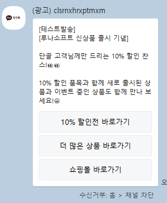

```
$ curl -X POST https://test-kakao-bizmessage.lunasoft.co.kr/api/v3/friendtalk/send
-H 'Accept: application/json'
-H 'Content-type: application/json'
-H 'agentKey: `사전에 블룸에이아이 운영 담당자를 통해 전달 받은 AgentKey`'
-d '{
    "ad_flag": "Y",
    "message_type": "FT",
    "message_key": "0000000001",
    "sender_key": "b564fa480f3b5c979a30531b9e6035cd5a258e56",
    "country_code": "82",
    "recipient_number": "01012345678",
    "message": "[블룸에이아이 신상품 출시 기념]\n\n단골 고객님께만 드리는 10% 할인 찬스!👀👀\n\n10% 할인 품목과 함께 새로 출시된 상품과 이벤트 중인 상품도 함께 만나 보세요!😁",
    "attachment": {
        "button": [
            {
                "type": "WL",
                "name": "10% 할인전 바로가기",
                "url_mobile": "https://lunasoft.co.kr/",
                "url_pc": "https://lunasoft.co.kr/"
            },
            {
                "type": "WL",
                "name": "더 많은 상품 바로가기",
                "url_mobile": "https://lunasoft.co.kr/",
                "url_pc": "https://lunasoft.co.kr/"
            },
            {
                "type": "WL",
                "name": "쇼핑몰 바로가기",
                "url_mobile": "https://lunasoft.co.kr/",
                "url_pc": "https://lunasoft.co.kr/"
            }
        ]
    }
}'
```

### 5.2 이미지 친구톡 발송 요청
+ 텍스트 메시지 + 링크 버튼 + 이미지 발송이 가능합니다.
+ 텍스트 문구는 400자로 제한됩니다.
+ 버튼은 최대 5개까지 등록하여 발송할 수 있습니다.
+ 반드시 카카오 비즈메시지 업로드 API를 통해 업로드 한 이미지를 발송해야 합니다.
<br/>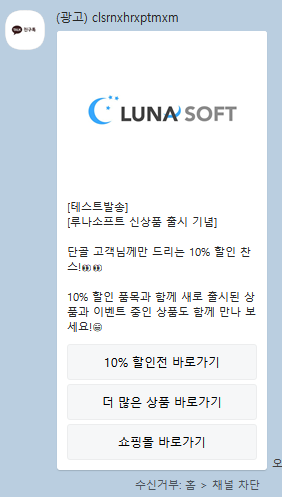

```
$ curl -X POST https://test-kakao-bizmessage.lunasoft.co.kr/api/v3/friendtalk/send 
-H 'Accept: application/json'
-H 'Content-type: application/json'
-H 'agentKey: `사전에 블룸에이아이 운영 담당자를 통해 전달 받은 AgentKey`'
-d '{
    "ad_flag": "Y",
    "message_type": "FI",
    "message_key": "0000000001",
    "sender_key": "b564fa480f3b5c979a30531b9e6035cd5a258e56",
    "country_code": "82",
    "recipient_number": "01012345678",
    "message": "[블룸에이아이 신상품 출시 기념]\n\n단골 고객님께만 드리는 10% 할인 찬스!👀👀\n\n10% 할인 품목과 함께 새로 출시된 상품과 이벤트 중인 상품도 함께 만나 보세요!😁",
    "attachment": {
        "image": {
            "img_url": "https://mud-kage.kakao.com/dn/bvV7Ki/btsnaRMJnk1/RWKh7CzFII1B7LMDuh9VgK/img_l.jpg",
            "img_link": "https://lunasoft.co.kr/"
        },
        "button": [
            {
                "type": "WL",
                "name": "10% 할인전 바로가기",
                "url_mobile": "https://lunasoft.co.kr/",
                "url_pc": "https://lunasoft.co.kr/"
            },
            {
                "type": "WL",
                "name": "더 많은 상품 바로가기",
                "url_mobile": "https://lunasoft.co.kr/",
                "url_pc": "https://lunasoft.co.kr/"
            },
            {
                "type": "WL",
                "name": "쇼핑몰 바로가기",
                "url_mobile": "https://lunasoft.co.kr/",
                "url_pc": "https://lunasoft.co.kr/"
            }
        ]
    }
}'
```

### 5.3 와이드 이미지 친구톡 발송 요청
+ 텍스트 메시지 + 링크 버튼(최대 2개) + 이미지 발송이 가능합니다.
+ 텍스트 문구는 76자로 제한됩니다.
+ 반드시 카카오 비즈메시지 업로드 API를 통해 업로드 한 와이드 이미지를 발송해야 합니다.
<br/>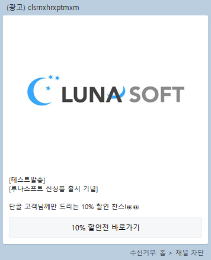

```
$ curl -X POST https://test-kakao-bizmessage.lunasoft.co.kr/api/v3/friendtalk/send 
-H 'Accept: application/json'
-H 'Content-type: application/json'
-H 'agentKey: `사전에 블룸에이아이 운영 담당자를 통해 전달 받은 AgentKey`'
-d '{
    "ad_flag": "Y",
    "message_type": "FW",
    "message_key": "0000000001",
    "sender_key": "b564fa480f3b5c979a30531b9e6035cd5a258e56",
    "country_code": "82",
    "recipient_number": "01012345678",
    "message": "[블룸에이아이 신상품 출시 기념]\n\n단골 고객님께만 드리는 10% 할인 찬스!👀👀",
    "attachment": {
        "image": {
            "img_url": "https://mud-kage.kakao.com/dn/bEPv6T/btsnal8nkyh/t44KYUFrAr0B4uN33hSMjk/img_l.jpg",
            "img_link": "https://lunasoft.co.kr/"
        },
        "button": [
            {
                "type": "WL",
                "name": "10% 할인전 바로가기",
                "url_mobile": "https://lunasoft.co.kr/",
                "url_pc": "https://lunasoft.co.kr/"
            }
        ]
    }
}'
```

### 5.4 와이드 아이템 리스트 친구톡 발송 요청
+ 여러 아이템 리스트를 attachment.item.list 필드에 담아서 발송이 가능합니다.
+ item > list > title 텍스트 문구는 첫번째 아이템은 25자, 2~4번째 아이템은 30자로 제한됩니다.
+ 최대 4개 / 최소 3개의 아이템 리스트가 필요합니다.
+ 버튼은 최대 2개까지 가능하며 가로 정렬되어 발송 됩니다.
+ 반드시 카카오 비즈메시지 업로드 API를 통해 업로드 한 와이드 아이템 리스트 이미지를 발송해야 합니다.
+ 광고 발송만 가능합니다.
<br/>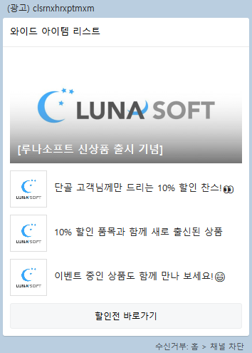

```
$ curl -X POST https://test-kakao-bizmessage.lunasoft.co.kr/api/v3/friendtalk/send 
-H 'Accept: application/json'
-H 'Content-type: application/json'
-H 'agentKey: `사전에 블룸에이아이 운영 담당자를 통해 전달 받은 AgentKey`'
-d '{
    "ad_flag": "Y",
    "message_type": "FL",
    "message_key": "0000000001",
    "sender_key": "b564fa480f3b5c979a30531b9e6035cd5a258e56",
    "country_code": "82",
    "recipient_number": "01012345678",
    "message": "",
    "header": "와이드 아이템 리스트",
    "attachment": {
        "button": [
            {
                "type": "WL",
                "name": "할인전 바로가기",
                "url_mobile": "https://lunasoft.co.kr/",
                "url_pc": "https://lunasoft.co.kr/"
            }
        ],
        "item": {
            "list": [
                {
                    "title": "[블룸에이아이 신상품 출시 기념]",
                    "img_url": "https://mud-kage.kakao.com/dn/cSYsPX/btsnaSdPdqb/OEqvy3kAhRb0GsQY6csi20/img_l.jpg",
                    "url_mobile": "https://lunasoft.co.kr/",
                    "url_pc": "https://lunasoft.co.kr/"
                },
                {
                    "title": "단골 고객님께만 드리는 10% 할인 찬스!👀",
                    "img_url": "https://mud-kage.kakao.com/dn/bwBNil/btsm4BZfP1V/7SaXD8Sfwz3km9NSUoyQTk/img_l.jpg",
                    "url_mobile": "https://lunasoft.co.kr/",
                    "url_pc": "https://lunasoft.co.kr/"
                },
                {
                    "title": "10% 할인 품목과 함께 새로 출신된 상품",
                    "img_url": "https://mud-kage.kakao.com/dn/JBvxN/btsm1TsiKGD/8pXYz23AwnQWzaC1lKmdWk/img_l.jpg",
                    "url_mobile": "https://lunasoft.co.kr/",
                    "url_pc": "https://lunasoft.co.kr/"
                },
                {
                    "title": "이벤트 중인 상품도 함께 만나 보세요!😁",
                    "img_url": "https://mud-kage.kakao.com/dn/nNiMe/btsnalN7GiK/w0dq2B7qo85F6qsowkqkZ1/img_l.jpg",
                    "url_mobile": "https://lunasoft.co.kr/",
                    "url_pc": "https://lunasoft.co.kr/"
                }
            ]
        }
    }
}'
```

### 5.5 캐러셀 피드 친구톡 발송 요청
+ carousel 필드에 list 로 추가 할 수 있고, 더보기 버튼(tail)을 지정하여 발송이 가능합니다.
+ 제목(헤더)은 20자, 텍스트 문구는 180자로 제한됩니다.
+ 캐러셀 하나 당 버튼은 최대 2개까지 가능하며 가로 정렬되어 발송 됩니다.
+ 캐러셀 1개당 제목(헤더) + 텍스트 문구 + 링크 버튼(2개/가로배열) + 이미지 발송 가능합니다.
+ 반드시 카카오 비즈메시지 업로드 API를 통해 업로드 한 캐러셀 이미지를 발송해야 합니다.
+ 광고 발송만 가능합니다.
<br/>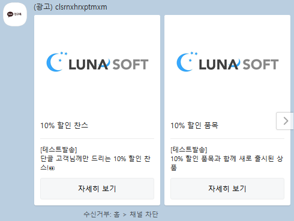

```
$ curl -X POST https://test-kakao-bizmessage.lunasoft.co.kr/api/v3/friendtalk/send 
-H 'Accept: application/json'
-H 'Content-type: application/json'
-H 'agentKey: `사전에 블룸에이아이 운영 담당자를 통해 전달 받은 AgentKey`'
-d '{
    "ad_flag": "Y",
    "message_type": "FC",
    "message_key": "0000000001",
    "sender_key": "b564fa480f3b5c979a30531b9e6035cd5a258e56",
    "country_code": "82",
    "recipient_number": "01012345678",
    "message": "",
    "carousel": {
        "list": [
            {
                "header": "깜찍한 춘식이 3in1 무선충전패드",
                "message": "프리런칭 5% 세일가에 득템해가라냥!",
                "attachment": {
                    "button": [
                        {
                            "type": "WL",
                            "name": "자세히 보기",
                            "url_mobile": "https://store.kakaofriends.com/products/10069",
                            "url_pc": "https://store.kakaofriends.com/products/10069"
                        }
                    ],
                    "image": {
                        "img_url": "https://mud-kage.kakao.com/dn/btHpr2/btsmQPRgeoY/A7HnPvVsh7XILMiQIQ9co1/img_l.jpg",
                        "img_link": "https://store.kakaofriends.com/products/10069"
                    }
                }
            },
            {
                "header": "ITS SO SWEET!",
                "message": "더운 요즘 자꾸 찾게 돼!\n달콤한 아이스크림에 빠진 프렌즈",
                "attachment": {
                    "button": [
                        {
                            "type": "WL",
                            "name": "자세히 보기",
                            "url_mobile": "https://store.kakaofriends.com/promotions/1756",
                            "url_pc": "https://store.kakaofriends.com/promotions/1756"
                        }
                    ],
                    "image": {
                        "img_url": "https://mud-kage.kakao.com/dn/JN2Ef/btsm2IJycuf/WnUObulakWRWi4Qn9knMqK/img_l.jpg",
                        "img_link": "https://store.kakaofriends.com/promotions/1756"
                    }
                }
            }
        ],
        "tail": {
            "url_mobile": "https://lunasoft.co.kr/",
            "url_pc": "https://lunasoft.co.kr/"
        }
    }
}'
```

### 5.6 커머스 친구톡 발송 요청
+ 부가 정보는 34자로 제한됩니다.
+ 버튼은 최소 1개 이상 포함되어야 하며, 최대 2개까지 포함 가능하며 가로 정렬되어 발송 됩니다.
+ 캐러셀 1개당 제목(헤더) + 텍스트 문구 + 링크 버튼(2개/가로배열) + 이미지 발송 가능합니다.
<br/>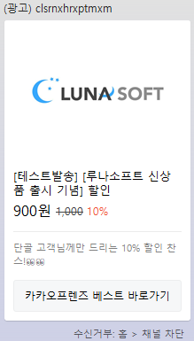

```
$ curl -X POST https://test-kakao-bizmessage.lunasoft.co.kr/api/v3/friendtalk/send 
-H 'Accept: application/json'
-H 'Content-type: application/json'
-H 'agentKey: `사전에 블룸에이아이 운영 담당자를 통해 전달 받은 AgentKey`'
-d '{
    "ad_flag": "Y",
    "message_type": "FM",
    "message_key": "0000000001",
    "sender_key": "b564fa480f3b5c979a30531b9e6035cd5a258e56",
    "country_code": "82",
    "recipient_number": "01012345678",
    "message": "",
    "additional_content": "단골 고객님께만 드리는 10% 할인 찬스!👀👀",
    "attachment": {
        "image": {
            "img_url": "https://mud-kage.kakao.com/dn/bvV7Ki/btsnaRMJnk1/RWKh7CzFII1B7LMDuh9VgK/img_l.jpg",
            "img_link": "https://lunasoft.co.kr/"
        },
        "button": [
            {
                "type": "WL",
                "name": "10% 할인전 바로가기",
                "url_mobile": "https://lunasoft.co.kr/",
                "url_pc": "https://lunasoft.co.kr/"
            }
        ],
        "commerce": {
            "title": "[블룸에이아이 신상품 출시 기념] 할인",
            "regular_price": 1000,
            "discount_price": 900,
            "discount_rate": 10,        // discount_rate, discount_fixed 둘 다 입력 시 discount_rate 우선
            "discount_fixed": 100
        }
    }
}'
```

### 5.7 프리미엄 동영상 친구톡 발송 요청
+ 동영상 링크는 카카오TV에 업로드된 영상만 사용 가능합니다.(https://tv.kakao.com/v/#{숫자} / https://tv.kakao.com/channel/#{숫자}/cliplink/#{숫자})
+ 헤더는 20자, 텍스트는 76자로 제한됩니다.
+ 헤더와 텍스트는 옵셔널한 값으로 없어도 발송 가능합니다.
+ 버튼은 1개까지 발송가능합니다.
<br/>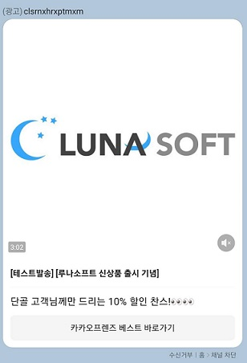

```
$ curl -X POST https://test-kakao-bizmessage.lunasoft.co.kr/api/v3/friendtalk/send 
-H 'Accept: application/json'
-H 'Content-type: application/json'
-H 'agentKey: `사전에 블룸에이아이 운영 담당자를 통해 전달 받은 AgentKey`'
-d '{
    "ad_flag": "Y",
    "message_type": "FP",
    "message_key": "0000000001",
    "sender_key": "b564fa480f3b5c979a30531b9e6035cd5a258e56",
    "country_code": "82",
    "recipient_number": "01012345678",
    "message": "단골 고객님께만 드리는 10% 할인 찬스!👀👀",
    "attachment": {
        "button": [
            {
                "type": "WL",
                "name": "10% 할인전 바로가기",
                "url_mobile": "https://lunasoft.co.kr/",
                "url_pc": "https://lunasoft.co.kr/"
            }
        ],
        "video": {
            "video_url": "https://tv.kakao.com/channel/2878006/cliplink/410632501",
            "thumbnail_url": "https://mud-kage.kakao.com/dn/bvV7Ki/btsnaRMJnk1/RWKh7CzFII1B7LMDuh9VgK/img_l.jpg"
        }
    },
    "header": "[블룸에이아이 신상품 출시 기념]"
}'
```

### 5.8 캐러셀 커머스 친구톡 발송 요청
+ 여러 커머스 말풍선을 캐러셀로 발송 가능합니다.
+ 캐러셀 인트로가 존재하는 경우 캐러셀은 최소 1개 이상 최대 6개 이하 발송 가능합니다.
+ 캐러셀 인트로가 존재하지 않는 경우 캐러셀은 최소 2개 이상 최대 6개 이하 발송 가능합니다.
+ 각 캐러셀마다 버튼은 1개 필수이며 최대 2개까지 지원합니다.
+ 캐러셀 1개당 상품 제목 + 가격정보 + 부가정보 + 링크 버튼(2개/가로배열) + 이미지 발송 가능합니다.
+ 광고 발송만 가능합니다.
<br/>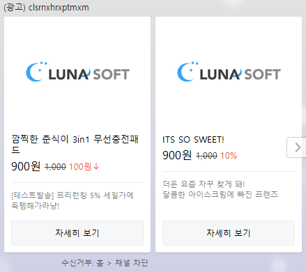

```
$ curl -X POST https://test-kakao-bizmessage.lunasoft.co.kr/api/v3/friendtalk/send 
-H 'Accept: application/json'
-H 'Content-type: application/json'
-H 'agentKey: `사전에 블룸에이아이 운영 담당자를 통해 전달 받은 AgentKey`'
-d '{
    "ad_flag": "Y",
    "message_type": "FA",
    "message_key": "0000000001",
    "sender_key": "b564fa480f3b5c979a30531b9e6035cd5a258e56",
    "country_code": "82",
    "recipient_number": "01012345678",
    "message": "",
    "carousel": {
        "list": [
            {
                "message": "프리런칭 5% 세일가에 득템해가라냥!",
                "attachment": {
                    "button": [
                        {
                            "type": "WL",
                            "name": "자세히 보기",
                            "url_mobile": "https://store.kakaofriends.com/products/10069",
                            "url_pc": "https://store.kakaofriends.com/products/10069"
                        }
                    ],
                    "image": {
                        "img_url": "https://mud-kage.kakao.com/dn/bvV7Ki/btsnaRMJnk1/RWKh7CzFII1B7LMDuh9VgK/img_l.jpg",
                        "img_link": "https://store.kakaofriends.com/products/10069"
                    },
                    "commerce": {
                        "title": "깜찍한 춘식이 3in1 무선충전패드",
                        "regular_price": 1000,
                        "discount_price": 900,
                        "discount_rate": null,
                        "discount_fixed": 100
                    }
                }
            },
            {
                "message": "더운 요즘 자꾸 찾게 돼!\n달콤한 아이스크림에 빠진 프렌즈",
                "attachment": {
                    "button": [
                        {
                            "type": "WL",
                            "name": "자세히 보기",
                            "url_mobile": "https://store.kakaofriends.com/promotions/1756",
                            "url_pc": "https://store.kakaofriends.com/promotions/1756"
                        }
                    ],
                    "image": {
                        "img_url": "https://mud-kage.kakao.com/dn/bvV7Ki/btsnaRMJnk1/RWKh7CzFII1B7LMDuh9VgK/img_l.jpg",
                        "img_link": "https://store.kakaofriends.com/promotions/1756"
                    },
                    "commerce": {
                        "title": "ITS SO SWEET!",
                        "regular_price": 1000,
                        "discount_price": 900,
                        "discount_rate": 10,
                        "discount_fixed": null
                    }
                }
            }
        ],
        "tail": {
            "url_mobile": "https://store.kakaofriends.com/home",
            "url_pc": "https://store.kakaofriends.com/home"
        }
    }
}'
```

### 5.9 쿠폰 발송 요청
+ 카탈로그형 발송 가능
+ 최소 3개 부터 최대 7개 발송 가능
+ 아이템 개수가 홀수 개(3, 5, 7개)의 경우, 첫 번째 이미지를 카탈로그 첫 번째 이미지 업로드를 활용하여 첫 번째 이미지를 등록해야 합니다.<br>이후 나머지 이미지 업로드는 카탈로그 이미지 업로드를 활용하여 등록합니다.
+ 아이템 개수가 짝수 개(4, 6개)의 경우, 카탈로그 이미지 업로드를 활용하여 이미지를 등록합니다.
+ 광고 발송만 가능합니다.
<br>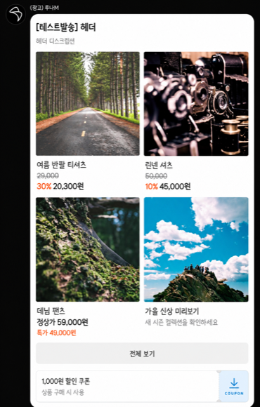

```
$ curl -X POST https://test-kakao-bizmessage.lunasoft.co.kr/api/v3/friendtalk/send 
-H 'Accept: application/json'
-H 'Content-type: application/json'
-H 'agentKey: `사전에 블룸에이아이 운영 담당자를 통해 전달 받은 AgentKey`'
-d '
{
    "ad_flag": "Y",
    "message_type": "FG",
    "message_key": "0000000001",
    "sender_key": "b564fa480f3b5c979a30531b9e6035cd5a258e56",
    "country_code": "82",
    "recipient_number": "01012345678",
    "header": "헤더",
    "header_description": "헤더 디스크립션",
    "attachment": {
        "button": [
            {
                "name": "전체 보기",
                "type": "WL",
                "url_mobile": "https://example.com",
                "url_pc": "https://example.com"
            }
        ],
        "coupon": {
            "title": "1000원 할인 쿠폰",
            "description": "상품 구매 시 사용",
            "url_mobile": "https://example.com"
        },
        "catalog": {
            "list": [
                {
                    "type": "COMMERCE_DISCOUNT",
                    "img_url": "https://mud-kage.kakao.com/dn/V7NUZ/dJMb998TOnf/gFB509keg8WWKo1zCB3Kfk/img_l.jpg",
                    "img_link": "https://www.yahoo.co.jp",
                    "title": "여름 반팔 티셔츠",
                    "regular_price": 29000,
                    "discount_price": 20300,
                    "discount_rate": 30,
                    "discount_fixed": 8700
                },
                {
                    "type": "COMMERCE_DISCOUNT",
                    "img_url": "https://mud-kage.kakao.com/dn/bjcYLg/dJMb998TOnc/ZyEXNYNYyMih5FxcQ0uiA1/img_l.jpg",
                    "img_link": "https://www.google.com",
                    "title": "린넨 셔츠",
                    "regular_price": 50000,
                    "discount_price": 45000,
                    "discount_rate": 10
                },
                {
                    "type": "COMMERCE_PRICE",
                    "img_url": "https://mud-kage.kakao.com/dn/cJvobh/dJMb998TOnd/TEUsaVZqKBtzDyyTrWsCr1/img_l.jpg",
                    "img_link": "https://www.naver.com",
                    "title": "데님 팬츠",
                    "regular_price": 59000,
                    "discount_price": 49000,
                    "regular_price_name": "정상가",
                    "discount_price_name": "특가"
                },
                {
                    "type": "CONTENT",
                    "img_url": "https://mud-kage.kakao.com/dn/7nJIA/dJMb998TOne/anciLOAfipU2U51UwPQqf1/img_l.jpg",
                    "img_link": "https://www.daum.net",
                    "title": "가을 신상 미리보기",
                    "description": "새 시즌 컬렉션을 확인하세요"
                }
            ]
        }
    }
}'
```

### 5.10 쿠폰 발송 요청
+ 쿠폰형은 모든 메세지 타입이 사용 가능합니다.
+ 세로형 버튼을 사용하는 FT, FI의 경우 쿠폰을 적용할 경우 최대 버튼 4개까지만 사용 가능합니다.
+ title의 경우 5가지 형식으로 제한 됩니다.
    + "${숫자}원 할인 쿠폰" 숫자는 1이상 99,999,999 이하
    + "${숫자}% 할인 쿠폰" 숫자는 1이상 100 이하
    + "배송비 할인 쿠폰"
    + "${7자 이내} 무료 쿠폰"
    + "${7자 이내} UP 쿠폰"
+ description의 경우 메시지 타입 FW(와이드 이미지), FL(와이드 아이템 리스트), FP(프리미엄 동영상) - 18자로 제한/ 나머지 - 12자로 제한 제한됩니다.

#### 5.10.1 이미지 친구톡 + 쿠폰 발송 요청
+ 텍스트 메시지 + 링크 버튼 + 이미지 + 쿠폰 발송이 가능합니다.
+ 텍스트 문구는 400자로 제한됩니다.
+ 버튼은 최대 4개까지 등록하여 발송할 수 있습니다.
+ 반드시 내부에 업로드 한 이미지를 발송해야 합니다.
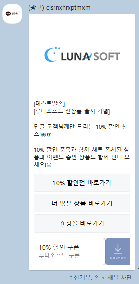

```
$ curl -X POST https://test-kakao-bizmessage.lunasoft.co.kr/api/v3/friendtalk/send 
-H 'Accept: application/json'
-H 'Content-type: application/json'
-H 'agentKey: `사전에 블룸에이아이 운영 담당자를 통해 전달 받은 AgentKey`'
-d '{
    "ad_flag": "Y",
    "message_type": "FI",
    "message_key": "0000000001",
    "sender_key": "b564fa480f3b5c979a30531b9e6035cd5a258e56",
    "country_code": "82",
    "recipient_number": "01012345678",
    "message": "[블룸에이아이 신상품 출시 기념]\n\n단골 고객님께만 드리는 10% 할인 찬스!👀👀\n\n10% 할인 품목과 함께 새로 출시된 상품과 이벤트 중인 상품도 함께 만나 보세요!😁",
    "attachment": {
        "image": {
            "img_url": "https://mud-kage.kakao.com/dn/bvV7Ki/btsnaRMJnk1/RWKh7CzFII1B7LMDuh9VgK/img_l.jpg",
            "img_link": "https://lunasoft.co.kr/"
        },
        "button": [
            {
                "type": "WL",
                "name": "10% 할인전 바로가기",
                "url_mobile": "https://lunasoft.co.kr/",
                "url_pc": "https://lunasoft.co.kr/"
            },
            {
                "type": "WL",
                "name": "더 많은 상품 바로가기",
                "url_mobile": "https://lunasoft.co.kr/",
                "url_pc": "https://lunasoft.co.kr/"
            },
            {
                "type": "WL",
                "name": "쇼핑몰 바로가기",
                "url_mobile": "https://lunasoft.co.kr/",
                "url_pc": "https://lunasoft.co.kr/"
            }
        ],
        "coupon": {
            "title": "10% 할인 쿠폰",
            "description": "블룸에이아이 쿠폰",
            "url_mobile": "https://lunasoft.co.kr/",
            "url_pc": "https://lunasoft.co.kr/"
        }
    }
}'
```

#### 5.9.2 와이드 이미지 친구톡 + 쿠폰 발송 요청
+ 텍스트 메시지 + 링크 버튼(최대 2개) + 이미지 + 쿠폰 발송이 가능합니다.
+ 텍스트 문구는 76자로 제한됩니다.
+ 반드시 내부에 업로드 한 와이드 이미지를 발송해야 합니다.
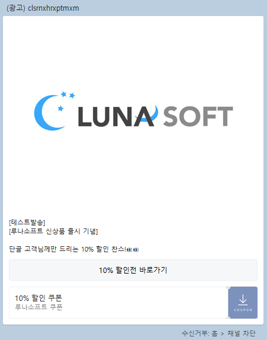

```
$ curl -X POST https://test-kakao-bizmessage.lunasoft.co.kr/api/v3/friendtalk/send 
-H 'Accept: application/json'
-H 'Content-type: application/json'
-H 'agentKey: `사전에 블룸에이아이 운영 담당자를 통해 전달 받은 AgentKey`'
-d '{
    "ad_flag": "Y",
    "message_type": "FW",
    "message_key": "0000000001",
    "sender_key": "b564fa480f3b5c979a30531b9e6035cd5a258e56",
    "country_code": "82",
    "recipient_number": "01012345678",
    "message": "[블룸에이아이 신상품 출시 기념]\n\n단골 고객님께만 드리는 10% 할인 찬스!👀👀",
    "attachment": {
        "image": {
            "img_url": "https://mud-kage.kakao.com/dn/bEPv6T/btsnal8nkyh/t44KYUFrAr0B4uN33hSMjk/img_l.jpg",
            "img_link": "https://lunasoft.co.kr/"
        },
        "button": [
            {
                "type": "WL",
                "name": "10% 할인전 바로가기",
                "url_mobile": "https://lunasoft.co.kr/",
                "url_pc": "https://lunasoft.co.kr/"
            }
        ],
        "coupon": {
            "title": "10% 할인 쿠폰",
            "description": "블룸에이아이 쿠폰",
            "url_mobile": "https://lunasoft.co.kr/",
            "url_pc": "https://lunasoft.co.kr/"
        }
    }
}'
```

#### 5.9.3 와이드 아이템 리스트 친구톡 + 쿠폰 발송 요청
+ 여러 아이템 리스트를 attachment.item.list 필드에 담아서 발송이 가능합니다.
+ item > list > title 텍스트 문구는 첫번째 아이템은 25자, 2~4번째 아이템은 30자로 제한됩니다.
+ 최대 4개 / 최소 3개의 아이템 리스트가 필요합니다.
+ 버튼은 최대 2개까지 가능하며 가로 정렬되어 발송 됩니다.
+ 반드시 내부에 업로드 한 와이드 아이템 리스트 이미지를 발송해야 합니다.
+ 광고 발송만 가능합니다.
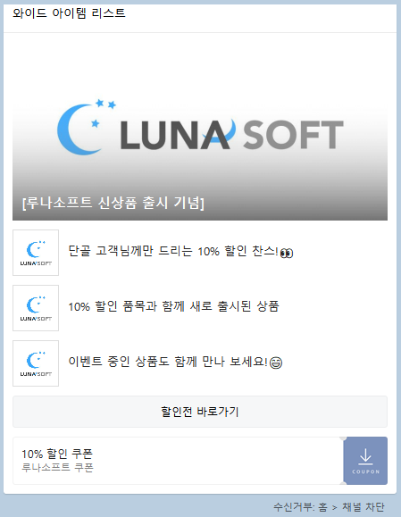

```
$ curl -X POST https://test-kakao-bizmessage.lunasoft.co.kr/api/v3/friendtalk/send 
-H 'Accept: application/json'
-H 'Content-type: application/json'
-H 'agentKey: `사전에 블룸에이아이 운영 담당자를 통해 전달 받은 AgentKey`'
-d '{
    "ad_flag": "Y",
    "message_type": "FL",
    "message_key": "0000000001",
    "sender_key": "b564fa480f3b5c979a30531b9e6035cd5a258e56",
    "country_code": "82",
    "recipient_number": "01012345678",
    "message": "",
    "header": "와이드 아이템 리스트",
    "attachment": {
        "button": [
            {
                "type": "WL",
                "name": "할인전 바로가기",
                "url_mobile": "https://lunasoft.co.kr/",
                "url_pc": "https://lunasoft.co.kr/"
            }
        ],
        "item": {
            "list": [
                {
                    "title": "[블룸에이아이 신상품 출시 기념]",
                    "img_url": "https://mud-kage.kakao.com/dn/cSYsPX/btsnaSdPdqb/OEqvy3kAhRb0GsQY6csi20/img_l.jpg",
                    "url_mobile": "https://lunasoft.co.kr/",
                    "url_pc": "https://lunasoft.co.kr/"
                },
                {
                    "title": "단골 고객님께만 드리는 10% 할인 찬스!👀",
                    "img_url": "https://mud-kage.kakao.com/dn/bwBNil/btsm4BZfP1V/7SaXD8Sfwz3km9NSUoyQTk/img_l.jpg",
                    "url_mobile": "https://lunasoft.co.kr/",
                    "url_pc": "https://lunasoft.co.kr/"
                },
                {
                    "title": "10% 할인 품목과 함께 새로 출신된 상품",
                    "img_url": "https://mud-kage.kakao.com/dn/JBvxN/btsm1TsiKGD/8pXYz23AwnQWzaC1lKmdWk/img_l.jpg",
                    "url_mobile": "https://lunasoft.co.kr/",
                    "url_pc": "https://lunasoft.co.kr/"
                },
                {
                    "title": "이벤트 중인 상품도 함께 만나 보세요!😁",
                    "img_url": "https://mud-kage.kakao.com/dn/nNiMe/btsnalN7GiK/w0dq2B7qo85F6qsowkqkZ1/img_l.jpg",
                    "url_mobile": "https://lunasoft.co.kr/",
                    "url_pc": "https://lunasoft.co.kr/"
                }
            ]
        },
        "coupon": {
            "title": "10% 할인 쿠폰",
            "description": "블룸에이아이 쿠폰",
            "url_mobile": "https://lunasoft.co.kr/",
            "url_pc": "https://lunasoft.co.kr/"
        }
    }
}'
```

## 6. 코드 정의
### 6.1 오류 코드

| code   | message                                                                   | 설명                                                                                                                                |
|--------|---------------------------------------------------------------------------|-------------------------------------------------------------------------------------------------------------------------------------|
| 0000   |                                                                           | 정상코드                                                                                                                            |
| 1001   | NoJsonBody                                                                | Request Body가 Json형식이 아님                                                                                                      |
| 1002   | InvalidHubPartnerKey                                                      | 허브 파트너 키가 유효하지 않음                                                                                                      |
| 1003   | InvalidSenderKey                                                          | 발신 프로필 키가 유효하지 않음                                                                                                      |
| 1004   | NoValueJsonElement                                                        | Request Body(Json)에서 name을 찾을 수 없음                                                                                          |
| 1006   | DeletedSender                                                             | 삭제된 발신프로필. (메시지 사업 담당자에게 문의)                                                                                    |
| 1007   | StoppedSender                                                             | 차단 상태의 발신프로필. (메시지 사업 담당자에게 문의)                                                                               |
| 1011   | ContractNotFound                                                          | 계약정보를 찾을 수 없음. (메시지 사업 담당자에게 문의)                                                                              |
| 1012   | InvalidUserKeyException                                                   | 잘못된 형식의 유저키 요청                                                                                                           |
| 1013   | InvalidAppLink                                                            | 유효하지 않은 app연결                                                                                                               |
| 1014   | InvalidBizNum                                                             | 유효하지 않은 사업자번호                                                                                                            |
| 1015   | TalkUserIdNotFonud                                                        | 유효하지 않은 app user id 요청                                                                                                      |
| 1016   | BizNumNotEqual                                                            | 사업자등록번호 불일치                                                                                                               |
| 1020   | InvalidReceiveUser                                                        | 전화번호 or app user id가 유효하지 않거나 미입력 요청                                                                               |
| 1021   | BlockedProfile                                                            | 차단 상태의 카카오톡 채널 (카카오톡 채널 운영툴에서 확인)                                                                           |
| 1022   | DeactivatedProfile                                                        | 닫힘 상태의 카카오톡 채널 (카카오톡 채널 운영툴에서 확인)                                                                           |
| 1023   | DeletedProfile                                                            | 삭제된 카카오톡 채널 (카카오톡 채널 운영툴에서 확인)                                                                                |
| 1024   | DeletingProfile                                                           | 삭제대기 상태의 카카오톡 채널 (카카오톡 채널 운영툴에서 확인)                                                                       |
| 1025   | SpammedProfile                                                            | 메시지차단 상태의 카카오톡 채널 (카카오톡 채널 운영툴에서 확인)                                                                     |
| 1030   | InvalidParameterException                                                 | 잘못된 파라메터 요청                                                                                                                |
| 2003   | FailedToSendMessageByNoFriendshipException                                | (테스트 발송) 카카오톡 채널을 추가하지 않았음                                                                                       |
| 2006   | FailedToMatchSerialNumberPrefixPattern                                    | **[<4.2 메시지 전송 요청>](#42-메시지-전송-요청)**에 명시된 시리얼넘버 형식 불일치                                                  |
| 3000   | UnexpectedException                                                       | 예기치 않은 오류 발생                                                                                                               |
| 3006   | FailedToSendMessageException                                              | 내부 시스템 오류로 메시지 전송 실패                                                                                                 |
| 3008   | InvalidPhoneNumberException                                               | 전화번호 오류                                                                                                                       |
| 3010   | JsonParseException                                                        | Json 파싱 오류                                                                                                                      |
| 3011   | MessageNotFoundException                                                  | 메시지가 존재하지 않음                                                                                                              |
| 3012   | SerialNumberDuplicatedException                                           | 메시지 일련번호가 중복됨<br/>- 메시지 일련번호는 CS처리를 위해 고유한 값이 부여되어야 함.                                           |
| 3013   | MessageEmptyException                                                     | 메시지가 비어 있음                                                                                                                  |
| 3014   | MessageLengthOverLimitException                                           | 메시지 길이 제한 오류<br/>(텍스트 타입 1000자 초과, 이미지 타입 400자 초과, 캐러셀 180자 초과)                                      |
| 3018   | NoSendAvailableException                                                  | 메시지를 전송할 수 없음                                                                                                             |
| 3019   | MessageNoUserException                                                    | 톡 유저가 아님                                                                                                                      |
| 3021   | MessageNotSupportedKakaotalkException                                     | 톡 최소 버전 미지원                                                                                                                 |
| 3022   | NoSendAvailableTimeException                                              | 메시지 발송 가능한 시간이 아님<br/>(친구톡 / 마케팅 메시지는 08시부터 20시 50분까지 발송 가능)                                      |
| 3023   | MessageInvalidVideoException                                              | 메시지에 포함된 비디오를 전송할 수 없음<br>(비디오 주소 또는 썸네일 이미지 주소가 올바르지 않거나 썸네일 이미지가 규격에 맞지 않음) |
| 3024   | MessageInvalidImageException                                              | 메시지에 포함된 이미지를 전송할 수 없음<br>(이미지주소 또는 링크가 올바르지 않거나 이미지가 규격에 맞지 않음)                       |
| 3041   | MessageInvalidWideItemListLengthException                                 | 와이드 아이템 리스트 갯수 최대 최소 갯수 불일치                                                                                     |
| 3046   | ExceedMaxAdditionalContentLengthException                                 | 부가 정보 최대 길이 제한 오류                                                                                                       |
| 3047   | ExceedMaxCommerceTitleLengthException                                     | 커머스 정보 상품명 최대 길이 제한 오류                                                                                              |
| 3051   | InvalidateCarouselItemMinException or InvalidateCarouselItemMaxException  | 캐러셀 아이템 리스트 갯수 최소, 최대 갯수 불일치                                                                                    |
| 3052   | CarouselMessageLengthOverLimitException                                   | 캐러셀 아이템 메시지 길이 OVER                                                                                                      |
| 3056   | WideItemListTitleLengthOverLimitException                                 | 와이드 아이템 리스트 타이틀 길이 제한 오류                                                                                          |
| 3058   | CarouselHeaderLengthOverLimitException                                    | 캐러셀 헤더 길이 제한 오류                                                                                                          |
| 4000   | ResponseHistoryNotFoundException                                          | 메시지 전송 결과를 찾을 수 없음                                                                                                     |
| 4001   | UnknownMessageStatusError                                                 | 알 수 없는 메시지 상태                                                                                                              |
| 5000   | InvalidTestUser                                                           | (테스트 발송) 관리자 혹은 일회성 인증을 받은 사용자가 아님                                                                          |
| 5001   | DailyTestLimitExceeded                                                    | (테스트 발송) 일일 발송량 초과                                                                                                      |
| 9998   | 현재 서비스를 제공하고 있지 않습니다.                                     | 시스템에 문제가 발생하여 담당자가 확인하고 있는 경우                                                                                |
| 9999   | 시스템에서 알 수 없는 문제가 발생하였습니다. <br/>담당자가 확인 중입니다. | 시스템에 문제가 발생하여 담당자가 확인하고 있는 경우                                                                                |
| LS0000 | 발송 요청 성공                                                            | 발송 요청 성공                                                                                                                      |
| LS0001 | 잘못된 요청 JSON 또는 Querystring                                         | 잘못된 요청 JSON 또는 Querystring                                                                                                   |
| LS0002 | 유효하지 않은 AgentKey                                                    | 유효하지 않은 AgentKey                                                                                                              |
| LS0101 | 외부 서비스 API 타임 아웃                                                 | 카카오톡 비즈메시지 알림톡 API 타임 아웃                                                                                            |
| LS0102 | 외부 서비스 API Http Exception 발생                                       | 카카오톡 비즈메시지 알림톡 API Http Exception 발생                                                                                  |
| LS9999 | 블룸에이아이 API 내부 시스템 에러                                         | 블룸에이아이 API 내부 시스템 에러                                                                                                   |


## 7. 테스트 방법

### 7.1 Host
> **[개발서버]** [https://test-kakao-bizmessage.lunasoft.co.kr/](https://test-kakao-bizmessage.lunasoft.co.kr/)

### 7.2 테스트 선결 조건
+ 테스트 카카오톡 채널은 비즈니스 인증이 완료된 채널을 개발서버에 직접 등록하여 발송 가능합니다.
+ 테스트 수신자는 허브파트너의 관리자에 포함되어 있거나, [일회성 인증](/center-api.md#5-개발-서버-테스트-사용자-인증)을 받은 사용자만 가능합니다.
+ 하루에 발송 가능한 테스트 발송량은 허브파트너당 발송 성공 기준 친구톡 500건입니다.
+ 테스트 발송 시 메시지 내 텍스트 영역에 자동으로 [테스트발송] 말머리를 포함하여 발송되므로, 메시지 총 글자수가 1000자 이상일 경우 텍스트가 잘릴 수 있습니다. 최대 글자수에서 약 10글자 내외 여유를 두고 작성하시어 테스트 부탁 드립니다.
